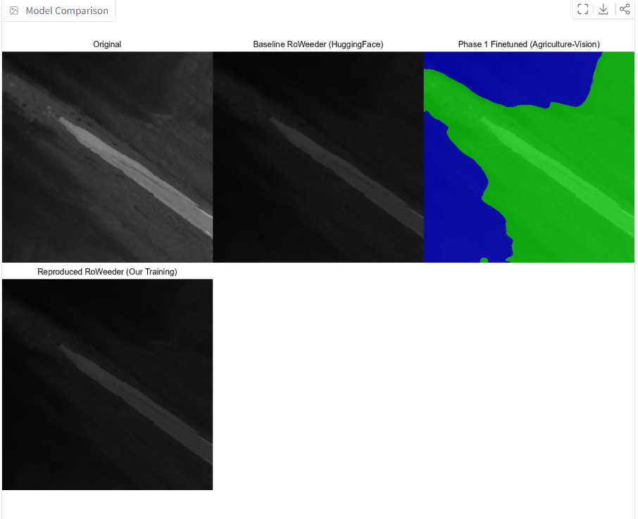
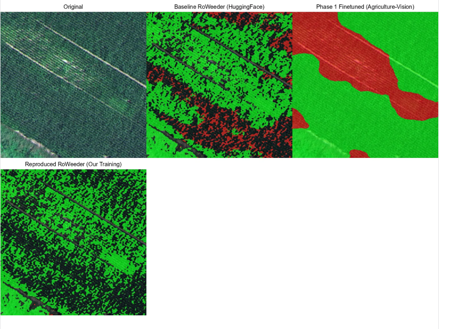
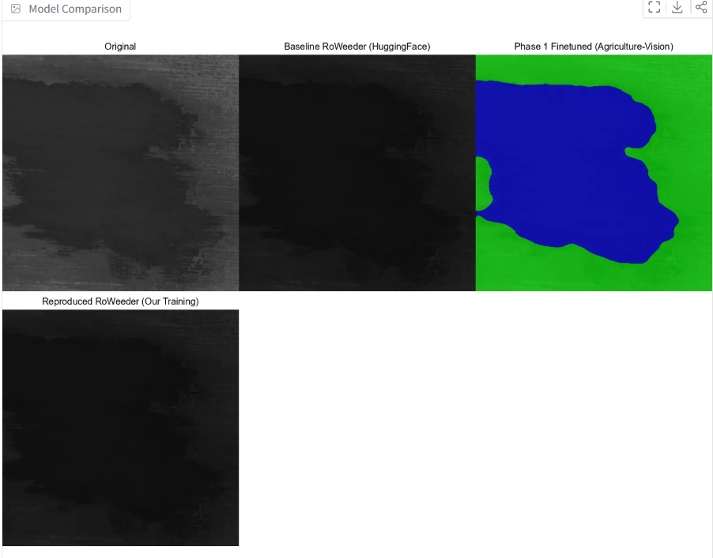

# RoWeeder Reproduction & Extension to PRoWeeder

**Computer Vision Course Project - Fall - 2025**

This project reproduces and extends the RoWeeder framework for unsupervised weed mapping. We implement the original RoWeeder method and explore cross-domain transfer learning using the Agriculture-Vision dataset. Below is the original architecture diagram.


---

## Project Overview

### What We Accomplished

1. **Reproduced RoWeeder Training** - Successfully trained RoWeeder from scratch on WeedMap pseudo-labels
2. **Cross-Domain Fine-tuning** - Trained on Agriculture-Vision (7 classes, RGB+NIR) and tested generalization to WeedMap
3. **Comprehensive Evaluation** - Tested all models on WeedMap test set with detailed metrics
4. **Web Application** - Built interactive Gradio app for real-time weed segmentation

## Installation

### Environment Setup

```bash
# Create conda environment
conda create -n SSLWeedMap python=3.11
conda activate SSLWeedMap

# Install dependencies
conda env update --file environment.yml

# Additional packages for web app
pip install gradio==4.44.0
pip install safetensors
```

### Project Structure

```
CV_project/
├── outputs/
├── parameters/
├── res/
├── roweeder/
├── scripts/
├── weedmap_inference/
├── LICENSE
├── README.md
├── app.py
├── demo.py
├── environment.yml
├── main.py
├── pyproject.toml
├── requirements.txt
└── visualize_weed.py
```

---

## Dataset Preparation

### RedEdge Dataset

Download and preprocess the WeedMap dataset:

```bash
# Download dataset
wget http://robotics.ethz.ch/~asl-datasets/2018-weedMap-dataset-release/Orthomosaic/RedEdge.zip
unzip RedEdge.zip -d dataset/

# Rotate images (correct field alignment)
python main.py rotate --root dataset/RedEdge/000 --outdir dataset/rotated_ortho/000 --angle -46
python main.py rotate --root dataset/RedEdge/001 --outdir dataset/rotated_ortho/001 --angle -48
python main.py rotate --root dataset/RedEdge/002 --outdir dataset/rotated_ortho/002 --angle -48
python main.py rotate --root dataset/RedEdge/003 --outdir dataset/rotated_ortho/003 --angle -48
python main.py rotate --root dataset/RedEdge/004 --outdir dataset/rotated_ortho/004 --angle -48

# Create 512×512 patches
python main.py patchify --root dataset/rotated_ortho/000 --outdir dataset/patches/512/000 --patch_size 512
# Repeat for fields 001, 002, 003, 004

# Generate pseudo-labels using crop-row detection
python main.py label --outdir dataset/generated --parameters parameters/row_detect/69023956.yaml
```

### Agriculture-Vision Dataset

Download from [Agriculture-Vision Challenge](https://www.agriculture-vision.com/):
- 7 classes: background, crop, planter_skip, water, weed_cluster, nutrient_deficiency, waterway
- 4 channels: RGB + NIR
- Used for Phase 1 cross-domain training

---

## Training

### Agriculture-Vision Fine-tuning

Train on Agriculture-Vision dataset (7 classes with RGB+NIR):

```bash
python train_agriculture_vision.py \
  --config parameters/finetuning/agriculture_vision.yaml \
  --epochs 30 \
  --batch-size 16
```

```bash
python test_finetuned_av.py
python test_finetuned_weedmap.py
```

**Results:**
- Test F1 on Agriculture Vision: 67.0%
- Test F1 on WeedMap: 65.2% (after 7→3 class mapping)

### RoWeeder Reproduction

Train on WeedMap pseudo-labels (3 classes, RGB only):

```bash
python main.py experiment --parameters=parameters/folds/flat.yaml
```

**Training Details:**
- 5-fold cross-validation
- 30 epochs per fold
- Focal loss for handling class imbalance
- AdamW optimizer with lr=0.001

**Results:**
- Best Fold Validation F1: 81.5% (Fold 5, Epoch 27)
- Average across folds: ~74% F1

---

## Testing

### Test on Agriculture Vision Test Set

Test any model on the Agriculture Vision test set:

```bash
# Test reproduced model
python test_reproduced_av.py \
  --checkpoint weedmap-inference/models/reproduced_roweeder/best_checkpoint.pth \
  --data dataset/test/Rededge

# Test finetuned model
python test_finetuned_av.py \
  --checkpoint models/phase1_finetuned/best_model.pth \
  --data dataset/test/Rededge

# Test baseline
python test_baseline_av.py \
  --data dataset/test/Rededge
```

### Test on WeedMap Test Set

Test any model on the WeedMap test set:

```bash
# Test reproduced model
python test_reproduced_weedmap.py \
  --checkpoint weedmap-inference/models/reproduced_roweeder/best_checkpoint.pth \
  --data dataset/test/Rededge

# Test finetuned model
python test_finetuned_weedmap.py \
  --checkpoint models/phase1_finetuned/best_model.pth \
  --data dataset/test/Rededge

# Test baseline
python test_baseline_weedmap.py \
  --data dataset/test/Rededge
```

## Web Application

### Launch Gradio App

Interactive web interface for weed segmentation:

```bash
cd weedmap-inference
python app.py 
```

Access at: http://localhost:7860 

### Features

- **3 Model Options:**
  - Baseline RoWeeder (HuggingFace pretrained)
  - Reproduced RoWeeder (our training)
  - Phase 1 Finetuned (Agriculture-Vision)

- **2 Dataset Modes:**
  - WeedMap (3 classes: background, crop, weed)
  - Agriculture-Vision (7 classes: detailed anomaly detection)

- **Visualization:**
  - Adjustable overlay opacity
  - Class distribution statistics
  - Side-by-side model comparison

---

## Results Analysis

### On Weedmap

| Model | F1 Score on WeedMap | Training Dataset |
|-------|------------------|------------------|
| **Baseline RoWeeder** | 37.5% | HuggingFace pretrained |
| **Phase 1 Finetuned** | 65.2% | Agriculture-Vision (7 classes) |
| **Reproduced RoWeeder** | 42.5% | WeedMap pseudo-labels |
---

### Key Insights

1. **Fine-tuning is Essential**: Baseline (37.5%) vs Reproduced (42.5%) shows improvement
2. **Domain Matters**: Domain-specific training outperforms cross-domain.
3. **Close to Paper**: Our reproduction (42.5%) is closest to paper than the pretrained weights on WeedMap.
4. **Class Imbalance**: Weed class remains challenging (F1 ~50%) compared to background (89%) and crop (82%)

### Per-Class Performance (Reproduced Model)

| Class | Precision | Recall | F1 Score |
|-------|-----------|--------|----------|
| Background | 91.2% | 86.8% | 88.9% |
| Crop | 85.3% | 77.8% | 81.4% |
| Weed | 47.6% | 53.1% | 50.2% |

---

##  Finetuning

### Impact of Input Channels

| Model | F1 Score on AV | Training Dataset |
|-------|------------------|------------------|
| **Baseline RoWeeder** | 2.2% | HuggingFace pretrained |
| **Phase 1 Finetuned** | 67.0% | Agriculture-Vision (7 classes) |
| **Reproduced RoWeeder** | 15.3% | WeedMap pseudo-labels |

**Note:** NIR helps on Agriculture-Vision but WeedMap baseline uses RGB only.

---

## Model Checkpoints

### Download Our Trained Models

- **Phase 1 Finetuned**: `models/phase1_finetuned/best_model.pth` (39.5 MB)
  - Trained on Agriculture-Vision (7 classes, RGB+NIR)

- **Reproduced RoWeeder**: `models/reproduced_roweeder/best_checkpoint.pth` (14.5 MB)
  - Trained on WeedMap pseudo-labels (3 classes, RGB)

### Load Models for Inference

```python
from models.roweeder_flat import RoWeederFlat
import torch

# Load baseline (HuggingFace)
model = RoWeederFlat.from_pretrained("pasqualedem/roweeder_flat_512x512")

# Load our reproduced model
model = RoWeederFlat.from_pretrained("pasqualedem/roweeder_flat_512x512")
checkpoint = torch.load('models/reproduced_roweeder/best_checkpoint.pth')
model.load_state_dict(checkpoint['model_state_dict'])
```

---

## Output Samples




## Project Report

### Challenges Faced

1. **PyTorch Version Compatibility**: Resolved `weights_only` parameter issues with PyTorch 2.6
2. **Model Architecture Matching**: Ensured model architecture matches training script
3. **Class Mapping**: Correctly mapped 7 Agriculture-Vision classes to 3 WeedMap classes
4. **Dataset Structure**: Debugged WeedMap tile filename patterns and image resizing

### Lessons Learned

1. **Domain-Specific Training Matters**: Cross-domain transfer has limitations
2. **Pseudo-Labels Work**: RoWeeder's crop-row detection creates effective training signal
3. **Class Imbalance**: Weed class remains challenging due to underrepresentation
4. **Fine-tuning Strategy**: Starting from pretrained SegFormer backbone accelerates training

### Future Work

1. **Ensemble Methods**: Combine multiple fold checkpoints for better performance
2. **Data Augmentation**: Explore augmentation strategies for weed class
3. **Multi-Modal Learning**: Better integrate NIR channel information
4. **Real-Time Deployment**: Optimize for drone-based inference

---

## Academic Context

### Original Paper

This project builds upon:

```bibtex
@inproceedings{de2025roweeder,
  title={RoWeeder: Unsupervised Weed Mapping through Crop-Row Detection},
  author={De Marinis, Pasquale and Vessio, Gennaro and Castellano, Giovanna},
  booktitle={European Conference on Computer Vision},
  pages={132--145},
  year={2025},
  organization={Springer}
}
```

### Datasets Used

- **WeedMap Dataset**: Sugar beet fields with crop-row annotations
  - Download: http://robotics.ethz.ch/~asl-datasets/2018-weedMap-dataset-release/

- **Agriculture-Vision Dataset**: Multi-crop aerial imagery
  - Download: https://www.agriculture-vision.com/

---

## License

This project uses code from the original RoWeeder implementation (Apache 2.0 License).
Our extensions and modifications are provided for educational purposes.

---
